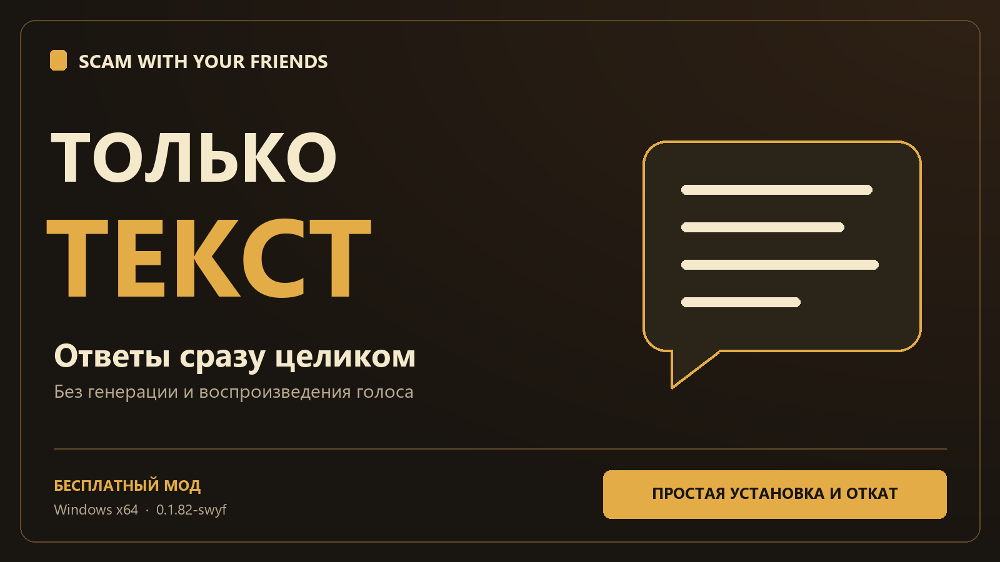
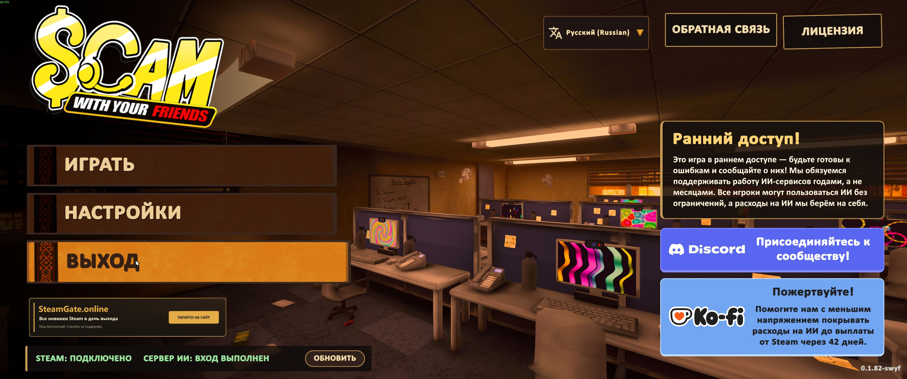
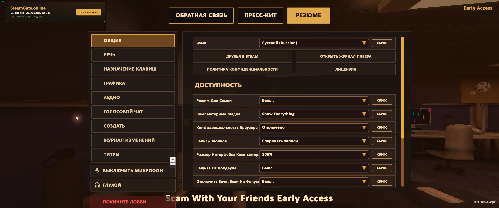

# Scam With Your Friends — Только текст

**[Скачать мод](https://github.com/sincess1/scam-with-your-friends-text-only/releases/latest)** · v1.0.0 · Windows x64 · игра 0.1.82-swyf, Steam Build 26040630

Если собеседник долго молчит, а текст появляется с паузами, этот мод позволяет играть без его озвучки. Полученный ответ выводится сразу целиком: ждать генерации и воспроизведения голоса больше не нужно.

Ожидание текста от игрового сервера остаётся. Распознавание микрофона мод не ускоряет. Это не офлайн-режим.

Мод бесплатный; покупка и регистрация для его работы не нужны.

## Установка

1. Закройте игру. Скачайте ZIP из релиза и распакуйте его целиком в отдельную папку.
2. Запустите **«Установить.cmd»**. Дождитесь сообщения «Готово» и запускайте игру через Steam.

Установщик сам найдёт игру в библиотеках Steam. При запросе папки выберите ту, где находится `Scam With Your Friends.exe`. Обычно права администратора не нужны.

Дополнительные программы скачивать не требуется: используется штатный .NET Framework Windows. Оригинальных DLL игры в архиве нет; изменение подготавливается на вашем компьютере. Резервная копия проверяется по контрольной сумме.

## Как откатить

Закройте игру и запустите **«Откатить.cmd»**. Если распакованный архив уже удалён, используйте **`TextOnlyBackup\Restore.cmd`** в папке игры.

Вернётся исходная озвучка. Текущие сохранения не заменяются старой копией: прогресс остаётся вашим. Резервная копия исходной DLL и снимок папки `DaySaves` сохраняются в `TextOnlyBackup`.

## Совместимость

- Проверенная основа: Windows x64, **0.1.82-swyf**, Steam Build **26040630**.
- Установщик проверяет точный исходный файл и отказывается менять неизвестную сборку или модифицированную DLL.
- Квота, выплаты, дни и сохранения не меняются.
- Совместимость с другими модами, Linux и Steam Deck не проверена.

После обновления игры потребуется проверить совместимость с новым выпуском мода. Если автоматический откат остановился из-за изменившихся файлов, восстановите текущую версию через **Steam → Свойства игры → Установленные файлы → Проверить целостность**. Затем можно удалить только `ScamTextOnly.Runtime.dll` из `Scam With Your Friends_Data\Managed`. Резервную копию оставьте, если она ещё нужна.

## В игре

Главное меню с модом. Исходные кнопки игры сохранены.

Меню настроек и паузы.

## Частые вопросы

**Текст всё равно не появляется мгновенно после моего сообщения.**

Мод убирает ожидание голоса и постепенный показ уже полученного ответа. Сетевой запрос к игровому серверу и распознавание вашей речи остаются.

**Можно продолжать говорить в микрофон?**

Да. Мод меняет только голосовой ответ собеседника. Способ ввода выбирается в игре как обычно.

**Почему в меню появились кнопки SteamGate?**

Это поддержка бесплатного мода: в главном меню и паузе добавлена отдельная кнопка со ссылкой на наш сайт. Сайт открывается только по нажатию. Исходные кнопки меню сохраняются.

**Проверена ли совместная игра с разными наборами модов?**

Пока нет. Не обещаем ускорение для других участников лобби или совместимость с их модами.

**Установщик сообщает, что сборка не поддерживается.**

Проверьте версию игры и наличие других модов. Не заменяйте файлы вручную и не обходите проверку: дождитесь совместимого выпуска.

**Где сообщить об ошибке?**

В [Issues](https://github.com/sincess1/scam-with-your-friends-text-only/issues). Укажите версию игры и мода, что произошло, текст ошибки. Не прикладывайте ключи доступа, записи разговоров или личные данные.

Неофициальная модификация; авторы игры с ней не связаны. Mono.Cecil распространяется с лицензией, вложенной в архив.

Поисковые названия: Scam With Your Friends без озвучки, только текст, долгие ответы, текст целиком, задержка русского голоса, Text Only Mod.
